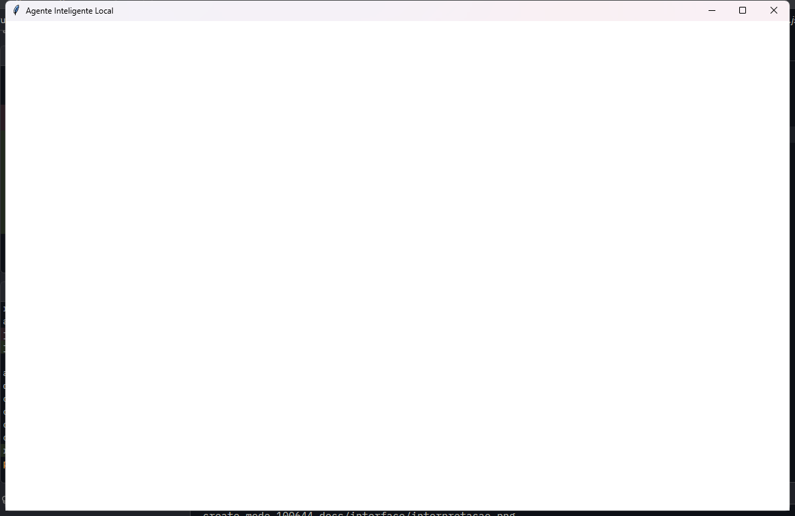
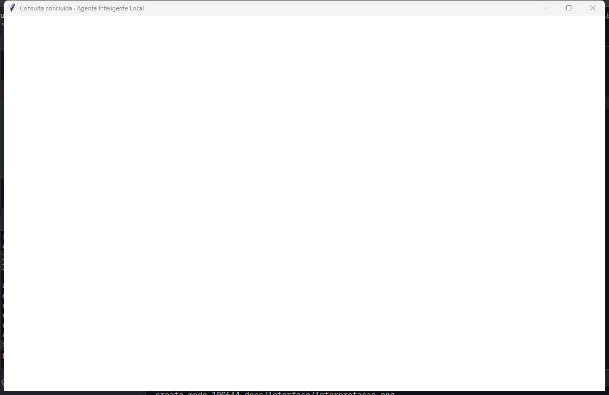
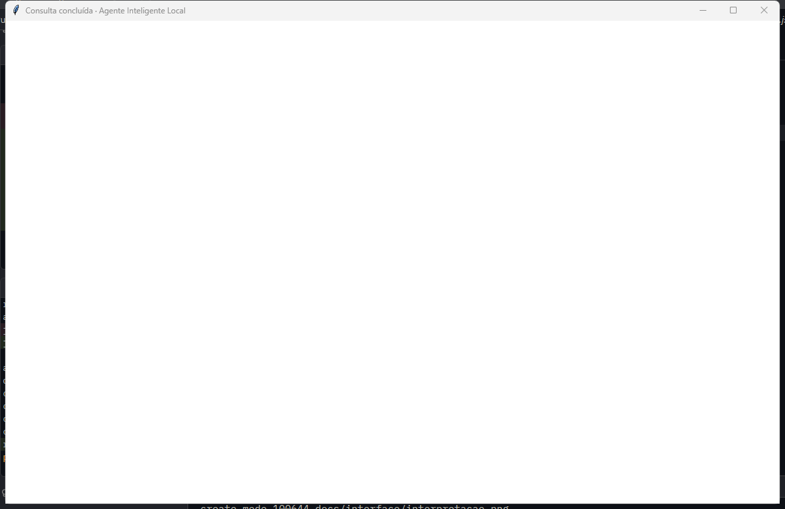
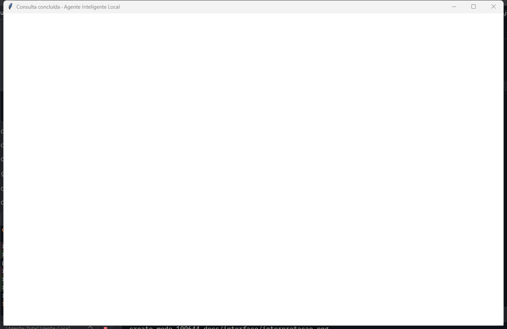
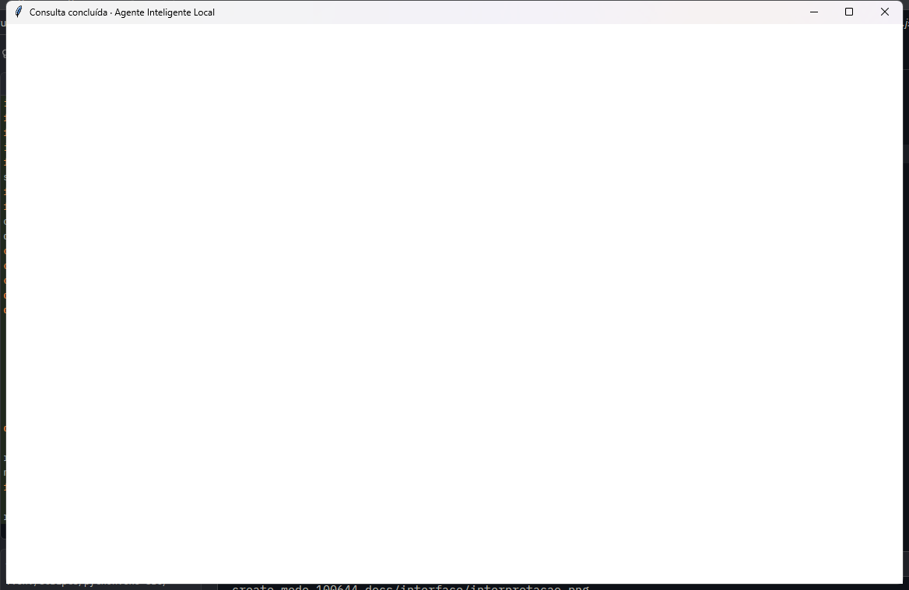

# Interface do Agente Inteligente Local

Capturas da interface Tk no Windows, em uma janela de 1152 × 720. Os resultados
usam respostas controladas do cenário de demonstração; os tempos e registros
ilustram a apresentação visual e não representam uma consulta em produção.
A comparação mostra a versão anterior à esquerda e a nova identidade à direita.

| Requisição | Processamento |
|---|---|
|  |  |

| SQL | Registros |
|---|---|
|  |  |

| Interpretação | Relacionamentos |
|---|---|
|  |  |

| Métricas |
|---|
|  |

## Comparação visual

O editor preserva a requisição quando uma etapa falha e indica a posição dos
erros de sintaxe. [Abrir captura do alerta de validação](erro.png)
