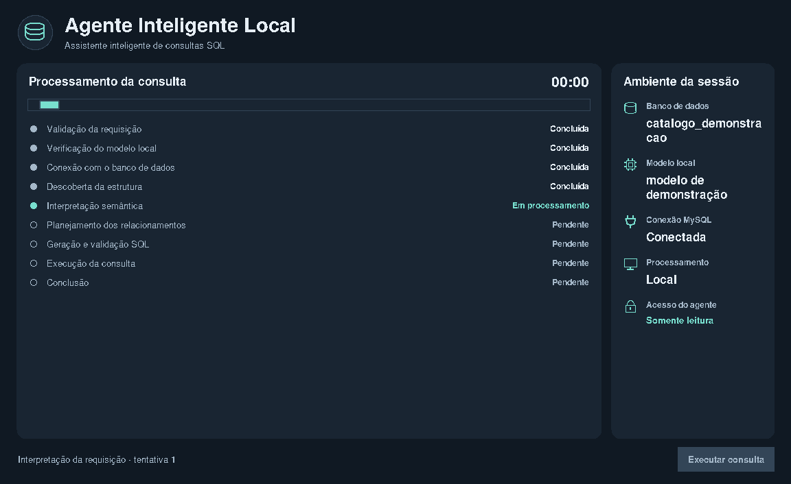

# Interface do Agente Inteligente Local

Capturas das janelas Tk em uma sessão gráfica Linux. A demonstração usou uma
base SQLite temporária e respostas controladas do modelo para exercitar o fluxo
do agente. Os tempos pertencem à execução de demonstração. As medições que o
modelo de teste não fornece aparecem com um traço.

| Requisição | Processamento |
|---|---|
|  |  |

| SQL | Registros |
|---|---|
|  |  |

| Interpretação | Métricas |
|---|---|
|  |  |

O editor preserva a requisição quando uma etapa falha e indica a posição dos
erros de sintaxe. [Abrir captura do erro de validação](erro.png)
