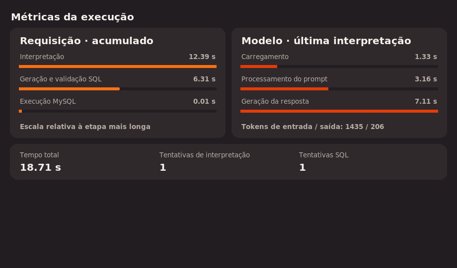
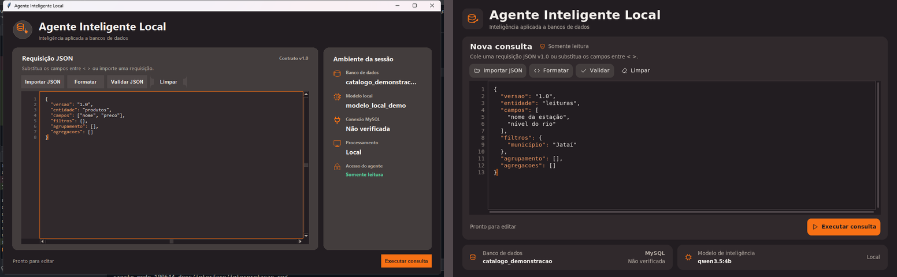

# Interface do Agente Inteligente Local

Capturas das janelas reais em Linux com Tk 8.6 e CustomTkinter. As janelas principais têm 1152 × 720 pixels. A demonstração usa uma requisição de leituras de estações, três tabelas e uma resposta controlada. Os valores e tempos ilustram a interface. O banco e o Ollama do usuário não foram acessados.

| Requisição JSON | Acompanhamento da consulta |
|---|---|
|  |  |

| SQL parametrizada | Registros recuperados |
|---|---|
|  |  |

| Interpretação e chaves estrangeiras | Detalhes técnicos |
|---|---|
|  |  |

[Abrir grafo em detalhe](relacionamentos.png) · [Ver erro de sintaxe no editor](erro.png)

## Antes e depois

À esquerda, a versão anterior da branch. À direita, a versão com o ambiente abaixo do editor.

